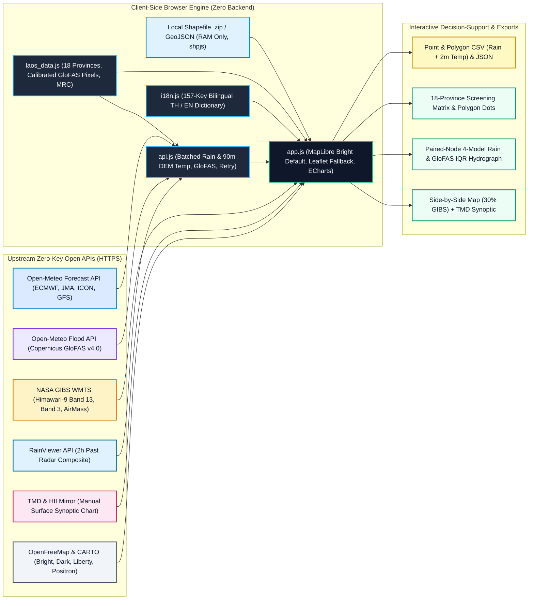

# Laos Real-Time Hydromet & Flood Monitor (Tier 1A Zero-Key)

**Real-Time Hydrometeorological, Flood Screening, Satellite & Synoptic Monitoring Web Application for Lao PDR (Zero-Key Client-Side Architecture)**


A zero-key, pure client-side operational hydrometeorological decision-support web application designed for **flood screening, orographic rainfall monitoring, catchment-scale Rain + 2m Temperature extraction, and synoptic weather analysis across all 18 provinces and major river basins of Lao PDR** (Mekong Mainstem, Nam Ou, Nam Ngum / Nam Lik, Nam Theun / Nam Kading, Xe Bangfai, Xe Banghiang, and Sekong / Xekaman).

Built for water resources engineers, reservoir operators, and flood forecasters, the application runs directly in any modern browser—**100% compatible with GitHub Pages (`https://`), local HTTP servers, and offline/field `file://` execution** without backend servers, API keys, or external file uploads.

---

## 1. Key Engineering Capabilities

### A. Paired-Node Orographic Screening & Calibrated 18-Province GloFAS Channels
In steep Lao PDR catchments, valley rain gauges and town-center coordinates systematically underestimate flash-flood and reservoir inflow potential caused by **orographic lifting** along mountain ridges (e.g., Annamite Range, Bolaven Plateau, and Northern Highlands). Every province tracks three coupled nodes:
1. **Valley / Administrative Town Node (`Town`):** Monitors urban exposure and valley-floor precipitation.
2. **Upstream Catchment Ridge Node (`Ridge`):** Tracks high-elevation headwater inflow zones with explicit DEM elevation differential ($\Delta \text{Elev}$).
3. **River-Calibrated Routing Node (`GloFAS`):** Samples **Copernicus GloFAS v4.0** river discharge ($m^3/s$). All 18 provinces' `glofas_point` coordinates in `laos_data.js` are calibrated via 5×5 (`±0.10°`, `0.05°` step) LISFLOOD grid scans so Mekong mainstem stations (`Vientiane`, `Bokeo`, `Luang Prabang`, `Sainyabuli`, `Bolikhamxai`, `Khammouane`, `Savannakhet`, `Champasak`) and major tributaries (`Nam Ou`, `Nam Ngum`, `Sekong`, `Xekaman`) sit directly on active river channels rather than dry adjacent floodplain pixels.

### B. 4-Model NWP Ensemble + Manual Synoptic Verification
Numerical Weather Prediction (NWP) models frequently diverge in convective intensity and tropical cyclone track timing over Mainland Southeast Asia:
- **4 Global NWP Models in Parallel:** Queries `ECMWF IFS` (~9 km), `JMA GSM` (~20–55 km), `DWD ICON` (~13 km), and `NOAA GFS` (~25 km) simultaneously over a **120-hour (5-day) hourly horizon** (`Asia/Bangkok`, UTC+7 ICT).
- **Side-by-Side Surface Synoptic Chart (`#workspace-split`):** Displays the **Thai Meteorological Department (TMD)** manual surface analysis (`00/06/12/18 UTC` isobars, Monsoon Trough / ITCZ axis, High/Low centers, and tropical cyclones) directly beside the interactive map—preserving true Lambert Conformal / Mercator chart geometry without web-tile distortion, with automatic **HII ThaiWater** fallback.

### C. 100% In-Browser Shapefile (`.zip`) / GeoJSON Upload & Areal Rain + 2m Temp Export
- **Zero-Server Privacy Architecture:** Project boundaries uploaded as **`.zip` Shapefiles** (parsed locally via `shpjs@6.2.0` UMD using `.shp`/`.dbf`/`.prj`) or **`.geojson` / `.json`** remain strictly in browser RAM (`0` bytes uploaded to any backend server). Built-in WGS84 bounds validation prevents misprojected coordinates when a `.zip` omits its `.prj` file.
- **Adaptive Interior Grid Sampling (`<= 50` Points):** Uses ray-casting point-in-polygon filtering with a default `0.08°` step (~9 km, matching `ECMWF IFS`), automatically coarsening step size to cap requests at **50 sample points** (or falling back to ring centroid for tiny sub-grid polygons) and rendering both boundary fill/outline and sample dots across basemap changes.
- **Dual Physical Elevation Handling (`Precipitation` vs. `2m Temperature`):** Batches queries (`<= 25` points/request) across all 4 models with separated elevation physics in `fetchPolygonRainAndTemp()`:
  - **Hourly Precipitation (`mm/h`):** Queries `&cell_selection=nearest&elevation=nan` for raw native NWP grid rainfall without elevation-based adjustment, applying uniform hourly deaccumulation on coarse 3h/6h steps.
  - **Hourly 2m Air Temperature (`°C`):** Queries `&cell_selection=nearest` **without `elevation=nan`**, preserving Open-Meteo's **90m DEM lapse-rate terrain correction** and recording each sample point's DEM elevation (`dem_elev_m`).
- **3 Clean CSV Exports:**
  1. **Point Rainfall CSV (`#btn-export-point-csv`):** 120h Town + Ridge 4-model & ensemble-mean rainfall (`mm/h`) for any selected province or custom Cursor-pinned site.
  2. **Polygon Areal Mean CSV (`#btn-shp-csv-areal`):** 120h catchment-average hourly `rain_*_mm` and `temp2m_*_c` across all 4 NWP models plus ensemble means.
  3. **Polygon Per-Grid-Point CSV (`#btn-shp-csv-grid`):** Full hourly matrix by `point_id` (`P01..P50`), requested/snapped coordinates, and `dem_elev_m`.

### D. Resilient Dual-Engine Map (`Bright` Default + `30%` Satellite) & Clean View
- **Calibrated Default Visual Layering:** Starts on **OpenFreeMap `Bright` (Standard Contrast)** vector basemap overlaid with **NASA GIBS Himawari-9 IR (`Band 13`) at `30%` default opacity**—balancing cloud-top visibility with crisp road, river, and terrain readability across both Light and Dark UI themes (theme switches never overwrite the active `Bright` basemap choice).
- **Primary & Fallback Engines:** Runs **MapLibre GL JS v4** with English Latin labels + localized DOM markers, and automatically switches to **Leaflet 1.9.4** raster tiles (`OSM` / `CARTO`) under local `file://` or non-WebGL environments.
- **Interactive Controls & Cursor Mode:** Supports hotkey Clean View (`H`), station pin toggle (`M`), collapsible TMD / 4-Model + GloFAS / 18-Province Matrix panels (with `0x0` ECharts and `ResizeObserver` guards), and interactive Cursor Pick relocation for `Town`, `Ridge`, and `GloFAS` nodes.

---

## 2. System Architecture



---

## 3. Repository Structure

| File | Size | Role & Responsibility |
| :--- | :---: | :--- |
| `index.html` | ~44 KB | Semantic application shell, side-by-side `#workspace-split`, `Bright` & `30%` defaults, `#shapefile-export-bar`, `shpjs@6.2.0` script tag, screening matrix, lightbox, and attribution footer |
| `styles.css` | ~31 KB | Responsive Dark/Light design system, split-grid layout, floating map drawers, `.shapefile-bar` controls, Clean View rules, and mobile/tablet breakpoints |
| `laos_data.js` | ~28 KB | Curated coordinates & DEM elevations for 18 Lao provinces (`town`, `ridge`, and 18 calibrated `glofas_point` river pixels), MRC mainstem stage thresholds, NWP specs, and GIBS layers |
| `api.js` | ~30 KB | Batched Open-Meteo 4-model & GloFAS v4.0 client, `fetchPolygonRainAndTemp()` (`elevation=nan` precip + 90m DEM `temperature_2m`), retry backoff, RainViewer & TMD URL builders |
| `app.js` | ~143 KB | Dual MapLibre/Leaflet controller (`bright` / `0.3` defaults), client-side Polygon normalizer, `<=50`-pt ray-cast sampler, ECharts 5 hydrographs, Cursor Picker, Point/Areal/Grid CSV exporters |
| `i18n.js` | ~29 KB | Complete **157-key** Thai (`th`) and English (`en`) UI dictionary with `data-i18n`, `data-i18n-placeholder`, and `data-i18n-title` synchronization |
| `start_tier1a.bat` | ~1 KB | Pure-ASCII Windows 1-click launcher (`python -m http.server 8765` + browser auto-open) |
| `.nojekyll` | 0 KB | Instructs GitHub Pages to serve static assets directly without Jekyll preprocessing |
| `LICENSE` | ~2 KB | MIT License for application code + upstream open-data attribution notice |

---

## 4. Quick Start & Deployment

### Option 1: Deploy Free on GitHub Pages (Global Mobile & Desktop Access)
1. Create a **Public** repository on GitHub (e.g., `laos-hydromet-monitor`).
2. Upload the files in this folder (`index.html`, `styles.css`, `i18n.js`, `laos_data.js`, `api.js`, `app.js`, `start_tier1a.bat`, `README.md`, `LICENSE`, `.gitignore`, `.nojekyll`) to the root of the `main` branch.
3. In your GitHub repository, navigate to **Settings ➔ Pages**:
   - Under **Build and deployment ➔ Source**, select **Deploy from a branch**.
   - Under **Branch**, select **`main`** and folder **`/ (root)`**, then click **Save**.
4. Wait ~60 seconds. Your live dashboard will be published at:
   `https://<your-github-username>.github.io/laos-hydromet-monitor/`

### Option 2: Run Locally on Windows (`http://127.0.0.1:8765/`)
Double-click `start_tier1a.bat` or run:
```powershell
python -m http.server 8765 --bind 127.0.0.1
```
Then open `http://127.0.0.1:8765/` in Chrome, Edge, or Firefox (enables full WebGL MapLibre GL JS vector tiles).

### Option 3: Direct Offline / Field `file://` Mode
Double-click `index.html` directly from Windows Explorer or macOS Finder. The application automatically detects the `file:` protocol and switches the map engine to **Leaflet 1.9.4** raster mode so APIs, GeoJSON polygon uploads, charts, and CSV exports continue to function without a local server.

---

## 5. Multi-Tier Flood Alert Screening Logic (`api.js`)

Each province is evaluated continuously in `computeAlertStatus()` (`api.js:473-491`) across coupled rainfall and river discharge indicators:
- **Peak 24h Paired-Node Rainfall ($\text{Rain}_{24\text{h, trigger}}$):** $\max(\text{Rain}_{24\text{h, town}}, \text{Rain}_{24\text{h, ridge}})$ from the 4-model ensemble mean over the next 24 hours.
- **GloFAS 14-Day Discharge Surge Ratio ($Q_{\text{surge}}$):** Ratio of the 14-day forecast ensemble maximum discharge ($Q_{\text{peak, 14d}}$) to the preceding 5-day baseline mean ($Q_{\text{base, 5d}}$), guarded by minimum flow floors ($Q_{\text{base, 5d}} \ge 25\text{ m}^3/\text{s}$ and $Q_{\text{peak, 14d}} \ge 50\text{ m}^3/\text{s}$ in `api.js:425, 478`) to prevent false alarms in dry headwaters.

| Alert Level | Score | Trigger Criteria (`api.js:481-489`) |
| :--- | :---: | :--- |
| **Flood / Critical (`flood`)** | `3` | $\text{Rain}_{24\text{h, trigger}} \ge 150\text{ mm}$ **OR** ($Q_{\text{peak, 14d}} \ge 50\text{ m}^3/\text{s}$, $Q_{\text{base, 5d}} \ge 25\text{ m}^3/\text{s}$, and $Q_{\text{surge}} \ge 2.5\times$) |
| **Alarm / Warning (`alarm`)** | `2` | $\text{Rain}_{24\text{h, trigger}} \ge 90\text{ mm}$ **OR** ($Q_{\text{peak, 14d}} \ge 50\text{ m}^3/\text{s}$, $Q_{\text{base, 5d}} \ge 25\text{ m}^3/\text{s}$, and $Q_{\text{surge}} \ge 1.8\times$) |
| **Watch / Advisory (`watch`)** | `1` | $\text{Rain}_{24\text{h, trigger}} \ge 35\text{ mm}$ **OR** ($Q_{\text{peak, 14d}} \ge 50\text{ m}^3/\text{s}$, $Q_{\text{base, 5d}} \ge 25\text{ m}^3/\text{s}$, and $Q_{\text{surge}} \ge 1.4\times$) |
| **Normal (`normal`)** | `0` | Below Watch thresholds across both rainfall and discharge indicators |

> **Engineering Note on MRC Stage vs. GloFAS Discharge:** For stations on the Mekong mainstem and Se Bang Fai (`Luang Prabang`, `Vientiane`, `Nong Khai`, `Paksane`, `Thakhek`, `Mahaxai`, `Savannakhet`, `Pakse` in `laos_data.js`), Mekong River Commission (MRC) alarm/flood stage heights (in meters) are displayed as reference metadata alongside GloFAS modeled river discharge ($m^3/s$). Tributary nodes without live stage telemetry are explicitly badged as `[Ungauged / Model-Derived]`.

---

## 6. Upstream Data Sources & Attribution

- **Weather & River Discharge Forecasts:** [Open-Meteo.com](https://open-meteo.com/) under [CC BY 4.0](https://creativecommons.org/licenses/by/4.0/) (Non-Commercial use), integrating **ECMWF IFS**, **JMA GSM**, **DWD ICON**, **NOAA GFS**, and **Copernicus CEMS GloFAS v4.0**.
- **Satellite Imagery:** [NASA GIBS WMTS](https://earthdata.nasa.gov/eosdis/science-system-description/eosdis-components/gibs) operating on **JMA Himawari-9 AHI** observations.
- **Weather Radar:** [RainViewer Public Weather Maps API](https://www.rainviewer.com/api.html) (past 2-hour composite radar reflectivity, Zoom $\le 7$).
- **Surface Synoptic Charts:** [Thai Meteorological Department (TMD)](https://www.tmd.go.th/) and [Hydro-Informatics Institute (HII ThaiWater)](https://tiwrm.hii.or.th/).
- **Basemap & Cartography:** [OpenFreeMap](https://openfreemap.org/), CARTO, and [© OpenStreetMap contributors](https://www.openstreetmap.org/copyright) under ODbL.
- **Client-Side Shapefile Parser:** [shpjs (`v6.2.0`)](https://github.com/calvinmetcalf/shapefile-js) UMD build (browser RAM only; zero server transfer).
